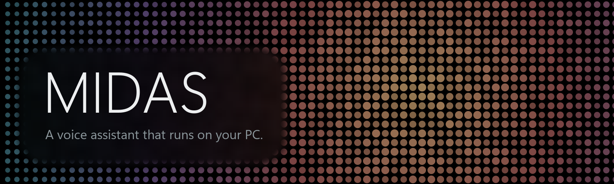

<p align="center">
  
</p>

MIDAS is a voice assistant for Windows that runs entirely on your own PC.
It uses local models through Ollama, so your conversations never leave
the machine.

- **Talks back.** Replies are spoken as they're written, and a dot grid
  in the window reacts to the voice.
- **Reminders.** Set and list them in plain language, and get alerted
  when they're due.
- **Morning briefing.** Weather, markets, news and a recap of overnight
  phone notifications, spoken at a time you choose.
- **Outfits.** Picks what to wear from your saved wardrobe, based on the
  weather and the occasion.
- **Phone control.** Ask MIDAS things from your phone through iOS
  Shortcuts, over Tailscale.

## Quick start

You need Windows, Python 3.12 or newer, and
[Ollama](https://ollama.com) running.

```
ollama pull qwen3:8b
py -3.12 -m venv venv
venv\Scripts\python.exe -m pip install -r requirements.txt
venv\Scripts\python.exe main.py
```

That's enough to chat. For speech, reminders, the briefing and outfits,
follow the [setup guide](docs/SETUP.md). It covers the other models,
the voice files, configuration, and running MIDAS in the background.

## Learn more

- [Setup and guide](docs/SETUP.md): installing, configuring, the phone
  API, and adding your own tools
- [Changelog](docs/CHANGELOG.md)
